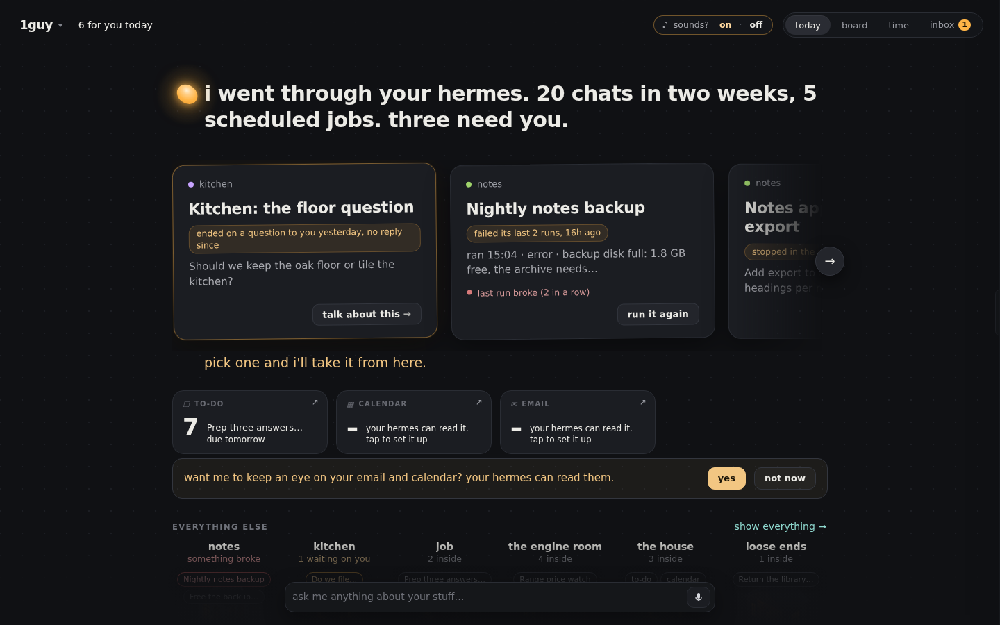
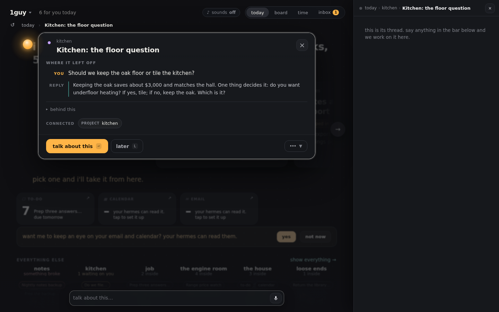
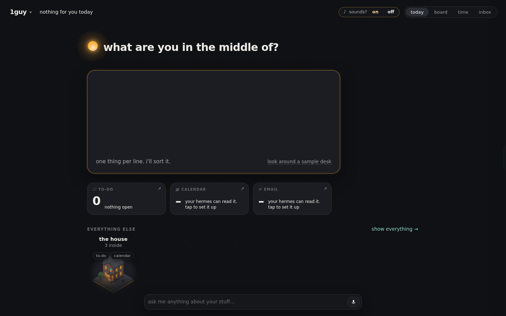
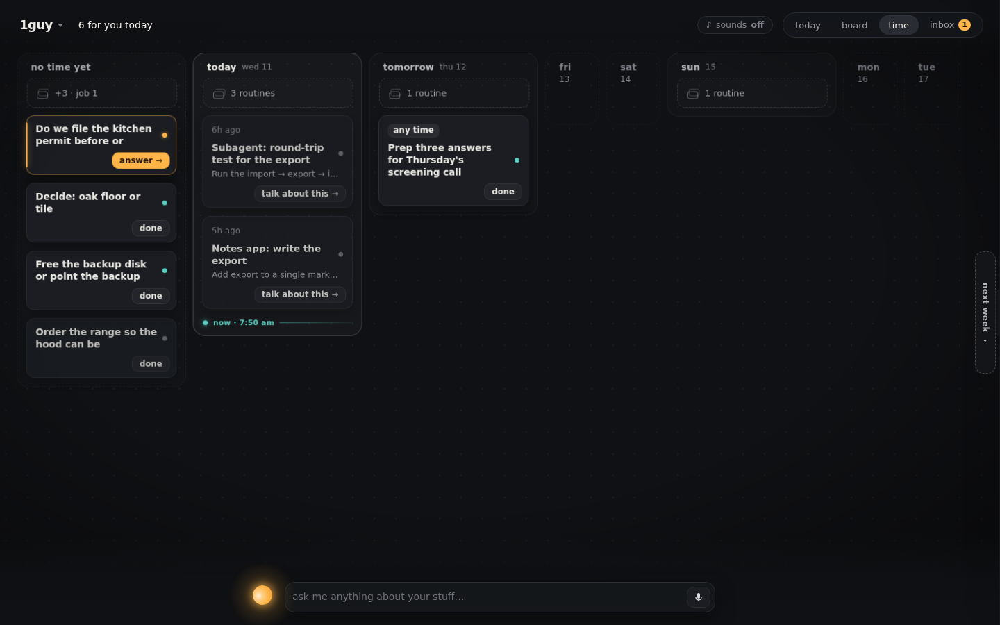
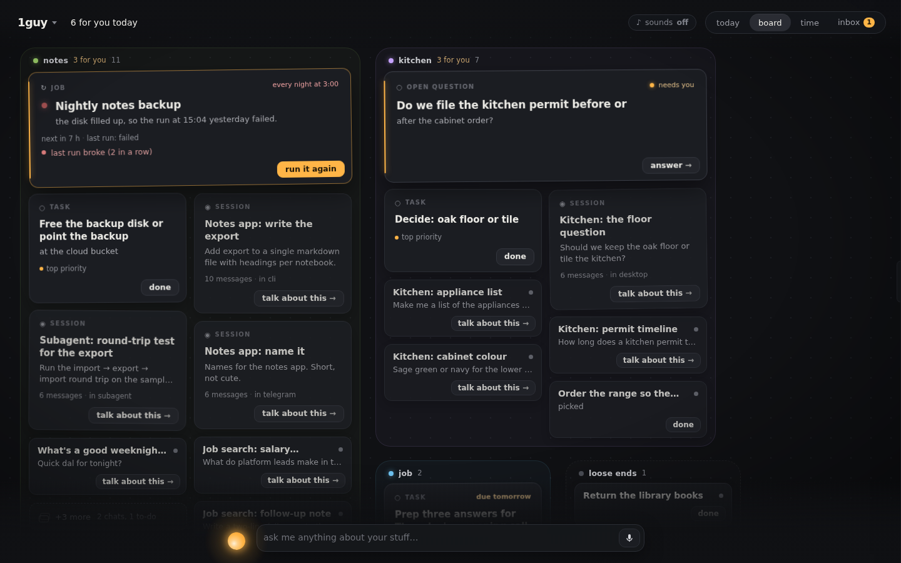

# 1guy

1guy is an early prototype of a bigger idea: the next interface should hold your
open work across sessions, not hand it off. The core loop works (opener, sorting
into piles, handing off a card). The edges are rough, built fast for this hackathon.

**Hermes does the work. 1guy brings it back to you.**

Running Hermes well means many sessions, scheduled jobs and helpers, and each one is a chat you
have to go back into. The work scatters: threads left half done, jobs that quietly fail, chats
that ended on a question for you. 1guy is one desk over your whole Hermes. Every session, job
and to-do is a card, every card is its own thread, and one guy on top reads all of it and tells
you the few things that need you.

Chat apps put artifacts inside conversations. 1guy puts the conversations inside your work.

It is yours: local, any model you already use, no network of its own, no telemetry.



## What you get

- **A page called 1guy** (sidebar row, or ⌘K → *Open 1guy*). It opens with one line about your
  day and a short "for you" rail: what is waiting on you, what broke, what is in motion.
  Everything else sits below in piles.
- **One item = one thread.** Tap a card and say something. The first time, 1guy starts a titled
  Hermes session for that item and hands it the item's context; after that the same card always
  resumes the same session. The reply streams into the card, and *hermes ↗* opens the full chat.
- **A talk bar.** Type a line. A command ("add buy stamps to my list") just happens. Anything
  else goes to the card it is about, or starts its own thread.
- **One button per card.** A card's face shows the one thing to do next; tap it for the focus
  view (*done*, *later*, and the rest behind ⋯). Esc steps back.
- **You can see him working.** Send a line about some cards and they are framed with what he is
  doing (*grouping…*, *scheduling…*) until it lands, fails, or you stop it.
- **What moved while you were away.** Anything he, a helper or your Hermes changed since you
  last looked wears a thin outline and one line of what happened (*this broke*, *replied in its
  thread*); his opener counts them, and looking at a card clears it.
- **Ask about several things at once.** Shift-drag a box round some cards (on a phone, long-press
  then drag) and type one question: it opens one new thread that names all of them.
- **Turn a pile into a brief.** Any pile of two or more cards can be written up as one short
  brief (your model writes it; with no model you get a plain list), filed as a card in that pile
  with links back to its sources.
- **Time is a place.** In the *time* lens, drag a to-do onto a day and it gets that date in
  your list. Cards say what is moving on them ("next run 6:30pm", "he's on it · 12m").
- **Proposals you can see before you say yes.** When he proposes a change (move these into a
  pile, put this on Friday), hold or hover its button and the cards show where they would go.
  Tap and it happens, one line in the ledger per change; undo takes all of it back.
- **Put things away.** Flick a card to the right to park it, drag cards together to pile them.
  The board remembers what you meant, not pixel positions.
- **Four ways to look at it.** *today* (the briefing), *board* (everything laid out), *time*
  (your week: what ran, what runs next, what is due) and *inbox* (what is waiting on you).
- **A docked ticker** under the conversation (⌘K → *Show 1guy dock*) and a small **to-do pane**
  (⌘K → *Show 1guy to-dos*, docked beside the conversation), for when the board is not on screen.



### The first time you open it

He goes through your Hermes and tells you what he found, in numbers he counted: *"i went through
your hermes. 38 chats in two weeks, 5 scheduled jobs. three need you."* The ones that need you are
real: a chat that ended on a question to you, a job whose last run failed, a thread left mid-task.

Then he proposes piles from your history (*"these 7 chats are all the garden project"*). Hold or
hover the button to see the cards slide into the pile; tap and they stay; undo puts them back.
Piles are suggested by your own model when one is available and by plain word-matching when it
is not, and a pile you turn down is never proposed again.


On a brand-new Hermes there is nothing to go through, so he asks: *"what are you in the middle
of?"* Type one thing per line. Each line is a card beside the box the moment you finish it and a
to-do in your `tasklist.md`; after a few he proposes piles over what you wrote.



If you only want to look, *look around a sample desk* loads a made-up world, marked SAMPLE on the
desk, where nothing is saved and nothing of yours is read; one tap leaves it. Nothing on your real
desk is ever invented.

| the week (*time*) | everything (*board*) |
|---|---|
|  |  |

## Install

```bash
hermes plugins install 1guy          # from the catalog
# or, from this repository:
hermes plugins install jrezmo/1guy-plugin
```

Then turn it on in **Capabilities → Plugins** in Hermes Desktop (the desktop half and the
backend half each have a switch; both are off until you say so) and open **1guy** from the
sidebar. Requires Hermes 0.23 or newer. There is nothing to configure and no API key to add.

The board fills itself from what your Hermes already has. A brand-new install shows a calm,
nearly empty board and an empty to-do list you can start typing into.

### Coming from an earlier build

Versions up to 1.0.1 used the plugin id `oneguy`. `scripts/migrate_from_oneguy.sh` shows what
it would change (dry run) and `--apply` does it: your threads and placements move with you and
the old folders are archived, not deleted.

## What it reads and writes

| | Path | Access |
|---|---|---|
| Sessions | `<HERMES_HOME>/state.db` | read-only (opened `mode=ro`) |
| Scheduled jobs | `<HERMES_HOME>/cron/jobs.json`, `cron/output/` | read-only |
| Skill and MCP server names | `<HERMES_HOME>/skills/` (folder names), `config.yaml` (`mcp_servers:` keys) | read-only, names only |
| Live agent runs | `<HERMES_HOME>/cache/delegation/live/` | read-only |
| To-do list | `<HERMES_HOME>/tasklist.md` | read and write; created if missing |
| Its own state | `<HERMES_HOME>/plugin-data/1guy/` | read and write |

`tasklist.md` is a plain markdown checklist that any Hermes session can also edit. 1guy only
flips, adds, edits, dates, moves or removes single lines. When an item gets a thread or a date
it appends a short anchor such as `^k7f2` to that line, so the card survives later edits.

`plugin-data/1guy/` holds the item → session map (`threads.json`), where you put things
(`home-state.json`), a log of your gestures (`judgments.jsonl`), the emails you put off or said
aren't yours (`mail_hidden.json`), cached plain-words headlines,
small remembered choices such as "sounds on" (`local.json`), briefs you asked for (`briefs/`), a short self-report log
(`client-errors.jsonl`: script errors, refused requests and load timings from the app, capped,
read back by `GET /diag`; it never leaves your machine) and a few bookkeeping files. Removing the plugin leaves this folder; delete it to forget
everything.

## Things you should know before installing

- **It uses your model.** To put plain words on cards, to name the piles it proposes from your
  history, to write a brief when you ask for one, and to decide where a typed line goes,
  the backend makes short calls on the model you already use, through Hermes's own plugin LLM
  access (`ctx.llm`). Those calls include card titles, summaries and short excerpts of your
  recent sessions and job output. They run in the background when cards are new or changed and
  they spend your tokens. Set `ONEGUY_HEADLINES=off` in the gateway's environment to turn the
  headline calls off; cards then show their raw titles.
- **It starts Hermes sessions.** Talking to a card creates a normal Hermes session (visible in
  your session list) and sends your message plus that card's context into it. The turn runs on
  your usual agent with your usual tools and approvals. Turns are started by the desktop app
  itself, so the board must be open in Hermes Desktop to talk to a card.
- **Email and calendar go through your own Hermes.** 1guy never reads mail or a calendar and
  holds no account. If your Hermes has an email or calendar skill (it looks at folder names under
  `skills/` and server names under `mcp_servers:` in `config.yaml`, nothing else), he offers to
  keep an eye on them. Saying yes creates ONE scheduled Hermes job, `1guy-mail-cal`, told to read
  only, and runs it once; the tiles and the *time* lens then show what that job last wrote. Say
  *not now* and he stops asking. Without such a skill the tiles say your Hermes can't read
  email yet. The inbox lists who is waiting on a reply, oldest first, with automated mail under
  it; `later`, `not mine` and `talk about this` on an email are only notes in 1guy's own log and,
  for the first two, a small list of hidden ids (`mail_hidden.json`). Nothing is ever done to
  your mailbox.
- **Three shell commands, each only when you ask.** *run now* on a job card runs
  `hermes cron run <job id>`. Saying yes to the email/calendar offer runs
  `hermes cron create … --name 1guy-mail-cal` and then `hermes cron run <that job>`. Nothing
  else is spawned.
- **No network.** The plugin makes no network calls of its own and has no telemetry. The canvas
  runs in a sandboxed frame whose content policy blocks every network request; its only way out
  is a message channel to the plugin's own backend. Its pictures are carried inside the page and
its sound cues (off until you say yes) are synthesized; nothing is downloaded.
- **No credentials.** It reads no key files and stores no secrets.

## Disclosures

- **Reads Hermes data outside its own folder.** All of your Hermes sessions (`state.db`,
  read-only), all scheduled jobs and their output (`cron/jobs.json`, `cron/output/`), live
  agent runs (`cache/delegation/live/`), and the names (only) of your skills and MCP servers.
  It reads **and writes** your to-do list, `tasklist.md`. Details in
  [What it reads and writes](#what-it-reads-and-writes).
- **Background processes.** Short-lived threads in the plugin's backend refresh card headlines
  (`ONEGUY_HEADLINES=off` stops them). *run now* on a job card starts `hermes cron run <id>` as a
  detached process that finishes on its own (its log goes to `plugin-data/1guy/logs/`). Saying yes to the email/calendar offer creates one recurring Hermes scheduled
  job, `1guy-mail-cal` (hourly, 07:00–22:00), that keeps running until you remove it with
  `hermes cron`. No daemon of its own, no self-update.
- **No network of its own.** The backend and the canvas make no outbound calls; model calls go
  through Hermes (`ctx.llm`) and spend your tokens. There is no direct mail or calendar reader:
  email and calendar come only through your own Hermes, as described above.
- **No telemetry.** The diagnostic log (`client-errors.jsonl`) stays in its own folder and is
  only read back by `GET /diag` on your own dashboard.

## If something looks wrong

1guy says so in plain words rather than showing a blank page. What you might see, and the one
thing to try:

| You see | It means | Try |
|---|---|---|
| **"1guy is not answering"** with a `reload` button | the desktop app could not reach the plugin's backend | check that 1guy is enabled under Capabilities → Plugins on the Hermes you are connected to, then `reload` |
| **"1guy did not finish loading"** with a `reload` button | the page was sent to its frame but never started | `reload`; if it keeps happening, update Hermes Desktop (1guy needs 0.23 or later) |
| a tile that says **"…isn't answering right now"** | that one source (the list, mail, calendar) failed this time; the rest of the desk is fine | wait for the next refresh, or reopen the page |
| email / calendar tiles that say **"your hermes can read it. tap to set it up"** | nothing is watching them yet (this is the normal state on a new install) | tap, if you want him to; see the disclosure above for what that creates |
| cards with plain titles and no headline, a brief that is a plain list | no model answered, so he fell back to the plain version | nothing is broken; check your Hermes model if you expected more |

For a bug report: `GET /api/plugins/1guy/diag` (behind the dashboard sign-in) returns the plugin
version, which canvas build it carries, and the last errors the app reported; the same lines are in
`<HERMES_HOME>/plugin-data/1guy/client-errors.jsonl`. Home-directory paths are shortened to `~` in them
before they are stored, and nothing is sent anywhere. Look through them before pasting; they can
include card ids and error text from your own desk.

## Not in this version

News cards and voice input. No composing mail, no accepting invites.

## How it is built

```
plugin.yaml  __init__.py          register(ctx): hands the backend ctx.llm, nothing else
desktop/plugin.js                 the desktop half: page, pane, dock, to-do pane, ⌘K commands
dashboard/plugin_api.py           thin router at /api/plugins/1guy/
og_core/
  store.py                        where state lives
  tasklist.py                     the markdown to-do list
  board.py                        sources → ranked blocks (adapter over the vendored board)
  talk.py                         talk bar, threads, agent turns relayed through the desktop app
  vendor/app/                     the 1guy canvas client and board code, vendored (see below)
  static/canvas.html              the canvas as one self-contained document
scripts/vendor_canvas.py          rebuilds vendor/ and static/ from a 1guy commit
tests/
```

The canvas is a web app that is shipped inside the plugin. A sandboxed frame cannot sign in to
the plugin backend, so the page is delivered as one document through `ctx.rest`, mounted with
the SDK's `SandboxedFrame`, and its API calls travel over `postMessage` to the desktop half,
which answers them with `ctx.rest`. Agent turns go the other way: the backend queues them and
the desktop half runs them on the app's own gateway connection (`session.create`,
`prompt.submit`, `session.interrupt`), then pushes what streams back.

`og_core/vendor/` and `og_core/static/canvas.html` are generated. `static/canvas.html`
is a readable, unminified bundle of the files in `vendor/app/home/`. To rebuild both from a
1guy commit: `python3 scripts/vendor_canvas.py <ref>` (needs `esbuild`, at build time only).

## Develop and test

```bash
uv venv .venv && uv pip install --python .venv/bin/python "fastapi>=0.100,<1.0" "pydantic>=2,<3" "httpx<1" "pytest<10" "uvicorn<1"
.venv/bin/pytest -q                  # backend, relay, and a browser run of the real plugin.js
tests/stranger_install.sh            # installs into a scratch Hermes home and drives it end to end
hermes plugins validate . --install-deps
```

Every test runs against a synthetic Hermes home built by `tests/make_home.py`.

## License

MIT. See [LICENSE](LICENSE).
